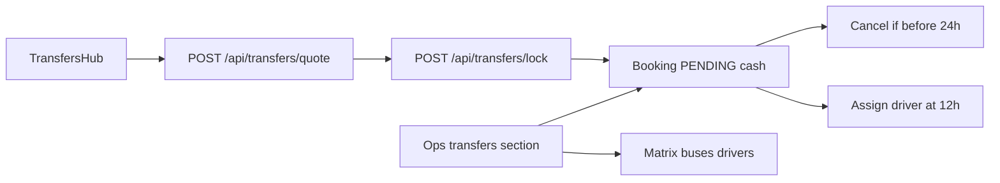

# Future ride booking

Turn the rides page into the unified hub from the HTML prototype: trip types, a real route builder, price lock with pay-later cash, bus resale, and a driver timeline. Operations edits the seeded timetable and sees margin. Travelers never see supplier cost.

The HTML at `Rehla-Future-Booking-Feature.html` (Desktop) is the UI spec. Live rides stay in [src/components/transfers/TransfersHubView.tsx](../src/components/transfers/TransfersHubView.tsx) on `/transfers`, `/transfers/local`, and `/transfers/intercity`. Today that form is two tabs (inside Dahab / anywhere), a 15-minute hold, and cash on arrival via [server/services/transferService.ts](../server/services/transferService.ts). There is no bus product, no driver table, and no agent view.

## Decisions

- Bus times are the prototype timetable, seeded once, then edited in the ops console. No live Go Bus API.
- Lock charges nothing. Free cancel until 24 hours before pickup. After that the ride is still cash on arrival (`CASH_ON_ARRIVAL`, payment stays `PENDING`). No Paymob charge.

One number mismatch: the message says Mansoura private 2,500 and bus+last-mile 650. The HTML matrix uses those figures for **Cairo**. Mansoura in the file is private **3,200** and bus+last-mile **780**. v1 follows the HTML matrix.

Local Masbat stays on the current formula in [server/data/transferRoutes.ts](../server/data/transferRoutes.ts): Shared Van **90**, Private Car **160**, Premium SUV **235**. Those cards gain the lock badge and the pay-later button. Long-haul uses the HTML zone matrix (Cairo private 2,500, bus 350 + last-mile 300 = 650).

## Pricing rules (server is the only calculator)

New [server/services/transferHubService.ts](../server/services/transferHubService.ts). The client sends origin, destination, tier, dates, passengers, add-ons, luggage, and trip type. The server returns the locked total. Lock recomputes and rejects a mismatched amount.

- **Short haul** (Dahab zone, Sharm, Nuweiba): existing `transferRouteService.quote()`. Shared stays per person, so the card says "90 / person" and the lock is `90 × passengers`. Private and premium lock the vehicle price. This removes the current surprise where the card shows 90 and the hold becomes 180.
- **Long haul** (Cairo, CAI, Mansoura, Alexandria, Hurghada, Luxor, Siwa, and the other matrix rows): sell = `round(matrix.private × tierFactor) + zoneAdd`. Factors from the HTML: shared 0.18, private 1, premium 1.42. Passengers do not change this price. Luggage +0 / +40 / +120. Each extra stop +250. Add-ons: child seat 0, extra stop 120, airport meet 150, pet 0, Blue Hole tour 200, XL luggage 80.
- **Round trip:** return leg = outbound vehicle price × 0.85 (15% off the return base only), plus the same add-ons once.
- **Early discount:** if pickup is at least 3 days out, subtract 12% from the total and store `earlyDiscountEGP`. The badge shows that real amount. The "saved 120" line in the HTML is not used as a price.
- **Bus + last-mile:** `schedulePrice + lastMile`, or the matrix bus price when no row is selected. Supplier cost = `supplierBus + max(0, lastMile - 50)`. The 50 is an editable driver subsidy, default 50. Cairo example: traveler pays 650, supplier cost 530, margin 120.
- **Margin is the spread** (`sell − supplierCost`). Do not also book the global 15% commission on these hub bookings, or the platform takes the spread twice. Existing Sharm SKUs (`SKU-TRF-001` and the commerce modal) keep today's 15% path.
- **Fleet calendar does not change the price.** It only marks the next 14 days busy or cheap from real locked bookings on that day. The fake "23 vehicles" and "Siwa route peak" strings are not shipped.

Public quote JSON omits `supplierPrivate`, `supplierBus`, and margin. Those fields exist only on `GET /api/operations/transfers/quote` for Operations and Admin.

## Traveler hub

Keep the three routes. [TransfersHubView](../src/components/transfers/TransfersHubView.tsx) becomes the shell. New pieces live beside it under `src/components/transfers/` so the file does not absorb the whole prototype.

Tabs replace the inside/anywhere split:

- **Private Transfers** — route, when, vehicle, review.
- **Intercity Buses** — seeded rows for that origin. Cairo shows Go Bus 11:40 PM Torgoman at 380, plus Blue Bus, We Bus, East Delta. Mansoura, Alexandria, Siwa, and Hurghada use their own rows. An origin with no rows shows an empty state, not Cairo's buses.
- **Future Fleet** — 14-day busy/cheap grid.

Route builder:

- **From:** Cairo, Cairo Airport (CAI), Sharm (SSH), Hurghada, Luxor, Mansoura, Alexandria, Nuweiba, Siwa, plus the current Dahab zones for local rides.
- **To:** Masbat, Assala, Eel Garden, Lagoon, Blue Hole, and Nuweiba or Siwa when the trip ends there (so Alexandria → Siwa is a real destination, not a label).
- Distance line uses the origin's km and duration. The Dahab zone only adds `priceAdd` (0 / 20 / 10 / 40 / 80).
- **Swap** exchanges the two ends and the server reprices. It does not cycle to the next city.

When:

- Full month calendar, past days disabled, time chips from the prototype, plus ASAP.
- ASAP assigns a driver now, skips the 12-hour blur, and gets no early discount.
- Copy and the API both use the same rule: free cancel until 24 hours before pickup.

Vehicle rail: the three tiers, badge "Price locked until departure", button "Lock this ride — Pay later". A second button on long-haul offers bus + last-mile. After lock, My Trip shows Booking → Driver Assigned → Pickup → Arrival, and the Blue Hole +200 add-on as the experience upsell.

Driver preview: three seeded verified drivers (initials, rating, languages, vehicle). No phone and no plate in the public payload. Cards stay blurred until `assignedResource` exists. Assignment runs when pickup is inside 12 hours, on telemetry read and on the ops poll, and ops can assign by hand. The assigned driver is written to the existing `assignedResource` and `transfer_telemetry` fields.

Sign-in and an active trip stay required, same as today.

All new copy goes in [src/i18n/translations.ts](../src/i18n/translations.ts), then `npm run i18n:emit`. No inline English or Arabic.

## Lock, cancel, capacity

`POST /api/transfers/lock` creates the booking immediately. It does not use the 15-minute hold. Payment provider is `CASH_ON_ARRIVAL`, `paymentState` stays `PENDING`, `supplierState` is `PENDING_CONFIRMATION`.

New optional fields on [BookingEntity](../server/db/schema.ts) (stored in the booking JSON document): `hubQuote` with trip type, stops, add-ons, `sellEGP`, `supplierCostEGP`, `earlyDiscountEGP`, `freeCancelUntil`, `busScheduleId`, `returnDate`.

`POST /api/transfers/bookings/:id/cancel` uses `req.user`. Allowed only for the trip owner, and only while `now < freeCancelUntil`. That releases the seat or vehicle. Inside 24 hours the API returns 409 and the ride stays booked. Cash was never taken, so there is no refund ledger entry.

Private lock reserves one vehicle on the inventory slot. Shared lock reserves seats. A bus lock decrements that timetable row's seats.

## Dashboard

Extend [src/components/operations/command-center/TransfersSection.tsx](../src/components/operations/command-center/TransfersSection.tsx) (already the transfers case in [CommandCenterShell.tsx](../src/components/operations/command-center/CommandCenterShell.tsx)). Four panes, Operations and Admin only:

- **Queue** — price-locked rides, cancel deadline, cash still due, driver still unassigned inside 12 hours, sell vs supplier vs margin.
- **Price matrix** — edit the zone rows (private, shared, bus, supplier costs, last-mile, zone add).
- **Bus timetable** — edit operator, departure, arrival, price, seats, origin.
- **Drivers** — edit the verified roster used for the 12-hour assign.

On the traveler page, Agent Mode is the same margin block, rendered only when the session role is Operations or Admin. Travelers do not get the toggle.

Supplier portal lists that supplier's assigned rides only. It does not show other suppliers' cost or the site margin.

Catalog seed lives in `server/data/transferHubCatalog.ts` and is inserted only when the new tables are empty, so a later boot does not wipe ops edits. New tables in [server/db/schema.ts](../server/db/schema.ts), [server/db/sqlite/tableSpecs.ts](../server/db/sqlite/tableSpecs.ts), and [server/db/migrations.ts](../server/db/migrations.ts): `transfer_zone_prices`, `transfer_bus_schedules`, `transfer_drivers`. Regenerate SQL with the existing schema script.

Routes go in a new [server/api/transferHubRoutes.ts](../server/api/transferHubRoutes.ts), mounted from `server.ts`. Register the file in `ROUTER_FILES` in [tests/contract/apiContract.test.ts](../tests/contract/apiContract.test.ts). Declare each path in [server/middleware/apiAccessPolicy.ts](../server/middleware/apiAccessPolicy.ts). Identity comes from the session.

## Tests

[tests/domain/transferHubQuote.test.ts](../tests/domain/transferHubQuote.test.ts):

- Masbat local: 90 / 160 / 235, shared × passengers.
- Cairo → Masbat private = 2,500; bus + last-mile = 650; margin 400 and 120.
- Mansoura → Masbat private = 3,200; bus + last-mile = 780.
- Round trip, extra stop, add-ons, and the 12% early cut.
- Public quote has no supplier fields.
- Cancel succeeds before 24 hours and returns 409 after.
- Lock is `PENDING` cash and survives a second call with the same idempotency key.

Then `npm run lint` and `npm test`. After the UI is in, walk `/transfers` in the browser: change From from Mansoura to Cairo and confirm the bus list and the 650 option; confirm a traveler session has no Agent Mode and an ops session does.

## Work slices

1. Add hub catalog seed, DB tables, and `transferHubService` quote math (local 90/160/235, Cairo 2500/650, early 12%, round trip, add-ons).
2. Add lock and cancel routes: PENDING cash booking, 24h free cancel, capacity, idempotency, supplier fields hidden from travelers.
3. Rebuild `TransfersHubView` into Private / Buses / Fleet with route builder, calendar, price-lock CTA, driver blur, and timeline. Run `npm run i18n:emit`.
4. Extend `TransfersSection` with queue, matrix, timetable, and driver editor. Agent Mode only for Operations and Admin.
5. Domain tests for quote, margin privacy, cancel window, and idempotent lock. Then lint, unit tests, and a browser pass on `/transfers`.
